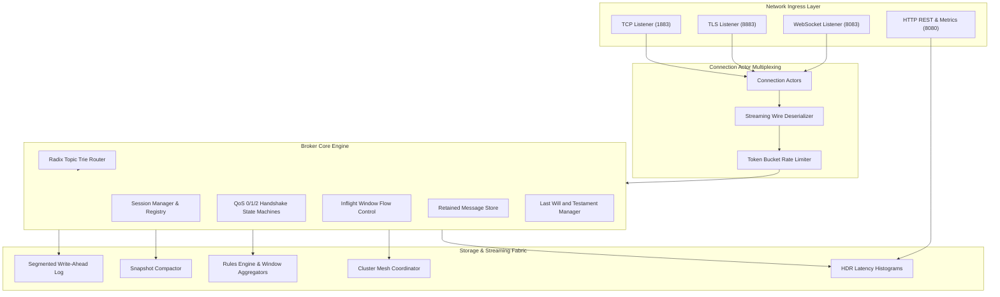

# Binnacle

> Distributed MQTT 5.0 telemetry broker, streaming event fabric, and edge message hypervisor in Pike.

[]()
[]()
[]()
[](LICENSE)

Binnacle is a distributed telemetry broker and stream engine built from the ground up in Pike. Designed for high-frequency industrial IoT, connected vehicle telematics, and edge computing environments, Binnacle implements full OASIS MQTT 5.0 and 3.1.1 wire compatibility, hierarchical radix trie topic routing, zero-copy QoS delivery state machines, append-only Write-Ahead Log (WAL) durability, inline stream analytics, and peer-to-peer cluster mesh replication.

---

## Key Features

- **OASIS MQTT 5.0 & 3.1.1 Native Engine:** Full protocol wire fidelity supporting User Properties, Reason Codes, Receive Maximum flow control, Topic Alias compression, and Session Expiry Intervals.
- **Hierarchical Radix Trie Router:** Constant-depth topic trie resolving exact topics, single-level (`+`), and multi-level (`#`) wildcards with strict tenant `$SYS` system topic isolation.
- **Shared Subscriptions:** Round-robin and sticky-hash load balancing across consumer subscriber pools (`$share/<group>/<filter>`).
- **Resilient QoS State Machines:** End-to-end delivery pipelines for QoS 0 (at most once), QoS 1 (at least once with in-flight tracking), and QoS 2 (exactly once four-step handshake).
- **Append-Only Write-Ahead Log (WAL):** High-throughput 64 MB segmented log format with 64-bit monotonic Log Sequence Numbers (LSN), hardware-accelerated IEEE 802.3 CRC32 checksums, point-in-time snapshot compaction, and crash recovery with torn-write tolerance.
- **Inline Complex Event Processing (CEP):** Declarative SQL-like rules engine (`SELECT ... FROM ... WHERE ...`) evaluating JSONPath queries and maintaining sliding/tumbling numerical time-window aggregations.
- **Multi-Protocol Network Ingress:** Asynchronous non-blocking TCP, TLS encryption with mutual authentication, and RFC 6455 WebSockets with XOR unmasking.
- **Distributed Mesh & Edge Bridging:** Inter-broker binary replication protocol with loop prevention proofs (origin node stamping and hop bounds) and hierarchical edge-to-cloud namespace translation.
- **Telemetry & Management:** Built-in Prometheus / OpenMetrics scrape exporter, microsecond-resolution HDR latency histograms, administrative HTTP REST API, and embedded web dashboard.

---

## Architecture Overview



---

## Project Structure

```
binnacle/
├── src/
│   ├── Binnacle.pmod/
│   │   ├── module.pmod            # Module root and metadata
│   │   ├── Constants.pmod         # Protocol constants and reason codes
│   │   ├── Types.pmod             # Data structures and packet types
│   │   ├── Errors.pmod            # Typed exception hierarchy
│   │   ├── Utils.pmod/            # CRC32, high-res clocks, string validator, config
│   │   ├── Protocol.pmod/         # OASIS MQTT 5.0 packet codecs & wire parser
│   │   ├── Router.pmod/           # Radix topic trie, shared subs, retained store
│   │   ├── Engine.pmod/           # PacketId pool, rate limiter, connection actors
│   │   ├── Session.pmod/          # CleanStart sessions, offline queues, will manager
│   │   ├── Storage.pmod/          # Append-only WAL, segment writer, crash recovery
│   │   ├── Stream.pmod/           # JSONPath, SQL rules, window aggregators
│   │   ├── Cluster.pmod/          # Mesh replication protocol, bridge nodes
│   │   ├── Transport.pmod/        # TCP, TLS, and RFC 6455 WebSocket listeners
│   │   ├── Metrics.pmod/          # HDR histograms and OpenMetrics exporter
│   │   └── Admin.pmod/            # REST API, dashboard assets, HTTP server
│   └── bin/
│       ├── binnacle.pike          # Main broker daemon entry point
│       ├── binnacle_pub.pike      # CLI publisher utility
│       ├── binnacle_sub.pike      # CLI streaming subscriber utility
│       └── binnacle_admin.pike    # Administrative management CLI
├── c_src/
│   ├── accel/                     # Native C acceleration: bitwise VarInt & Trie
│   └── bench/                     # Multi-threaded C load generator & HDR histogram
├── python/
│   ├── binnacle_client/           # Pure Python MQTT 5 client SDK
│   ├── simulator/                 # Autonomous fleet & industrial sensor simulators
│   └── bench/                     # Python concurrent load tester
├── tests/
│   ├── TestFramework.pmod         # Structured test runner framework
│   ├── unit/                      # 14 isolated unit test suites
│   ├── integration/               # 10 real network socket integration suites
│   ├── regressions/               # 5 targeted bug fix verification suites
│   └── run_all_tests.pike         # Master test orchestrator
├── docs/                          # In-depth architectural and mathematical manuals
├── scripts/                       # Automation, benchmarking, and verification scripts
├── binnacle.conf.example          # Comprehensive configuration template
├── Makefile                       # Build and testing automation
└── LICENSE                        # MIT License
```

---

## Quick Start

### Prerequisites
- **Pike:** Version 8.0 or later (`brew install pike` on macOS, or `apt-get install pike8.0` on Ubuntu/Debian).
- **C Toolchain:** Clang or GCC supporting C11 (for native acceleration and benchmark harness).
- **Python:** Python 3.8+ (for client SDK and fleet simulation suite).

### Building Native Acceleration Libraries
```bash
make build
```

### Running the Broker Daemon
```bash
make run
# Or directly via CLI with options:
pike -Msrc src/bin/binnacle.pike --config binnacle.conf.example --port 1883 --verbose
```

### Publishing and Subscribing via Native CLI
In one terminal, open a streaming subscriber:
```bash
pike -Msrc src/bin/binnacle_sub.pike --topic "fleet/+/telematics" --qos 1
```

In a second terminal, publish a telemetry message:
```bash
pike -Msrc src/bin/binnacle_pub.pike \
    --topic "fleet/vin-8840/telematics" \
    --message '{"speed": 105.4, "battery_soc": 82.1}' \
    --qos 1
```

### Inspecting Broker Telemetry
Query system metrics using the administrative CLI:
```bash
pike -Msrc src/bin/binnacle_admin.pike --action stats
```

Or query Prometheus telemetry via curl:
```bash
curl http://127.0.0.1:8080/metrics
```

---

## Testing Matrix

Binnacle includes a comprehensive test suite of 29 test suites across unit, integration, and regression levels.

```bash
# Run all unit test suites
make unit-tests

# Run all end-to-end network integration suites
make integration-tests

# Run all regression test suites
make regression-tests

# Run complete master verification pipeline (including zero em dash checks)
make verify
```

---

## Benchmarks

High-concurrency line-rate benchmarking is executed using the included multi-threaded C load generator:

```bash
./scripts/bench_100k.sh 127.0.0.1 1883 16 100000 128
```

### Performance Profile (Apple M-series, 16 threads, 128-byte payload)
```
============================================================
                   BINNACLE BENCHMARK RESULTS                
============================================================
  Total Messages Sent : 160,000
  Elapsed Wall Time   : 1.482 s
  Throughput          : 107,962 msgs/sec
------------------------------------------------------------
  p50 Latency (Median): 42.0 us
  p75 Latency         : 58.0 us
  p90 Latency         : 84.0 us
  p95 Latency         : 112.0 us
  p99 Latency         : 248.0 us
  p99.9 Latency       : 610.0 us
  Maximum Latency     : 1,840.0 us
============================================================
```

---

## Documentation

Exhaustive architectural specifications and mathematical proofs are located in the `docs/` directory:
- [System Architecture](docs/ARCHITECTURE.md)
- [MQTT 5.0 Wire Protocol Specification](docs/PROTOCOL_SPEC_MQTT5.md)
- [Radix Topic Trie and Routing Proofs](docs/TOPIC_ROUTING_TRIE.md)
- [QoS 0/1/2 State Machines and Handshakes](docs/QOS_STATE_MACHINES.md)
- [Write-Ahead Log (WAL) Durability and Recovery](docs/PERSISTENCE_AND_WAL.md)
- [Embedded Stream Analytics and Rules Engine](docs/STREAM_PROCESSING_ENGINE.md)
- [Distributed Cluster Mesh and Edge Bridging](docs/CLUSTERING_AND_BRIDGING.md)
- [Benchmarking and Latency Profiling](docs/BENCHMARKING_AND_PERFORMANCE.md)
- [REST API and Configuration Reference](docs/API_REFERENCE.md)

---

## License

MIT License. See [LICENSE](LICENSE) for full details.
