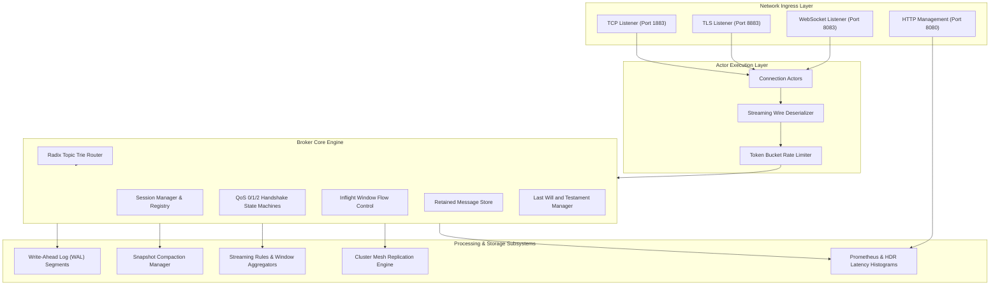
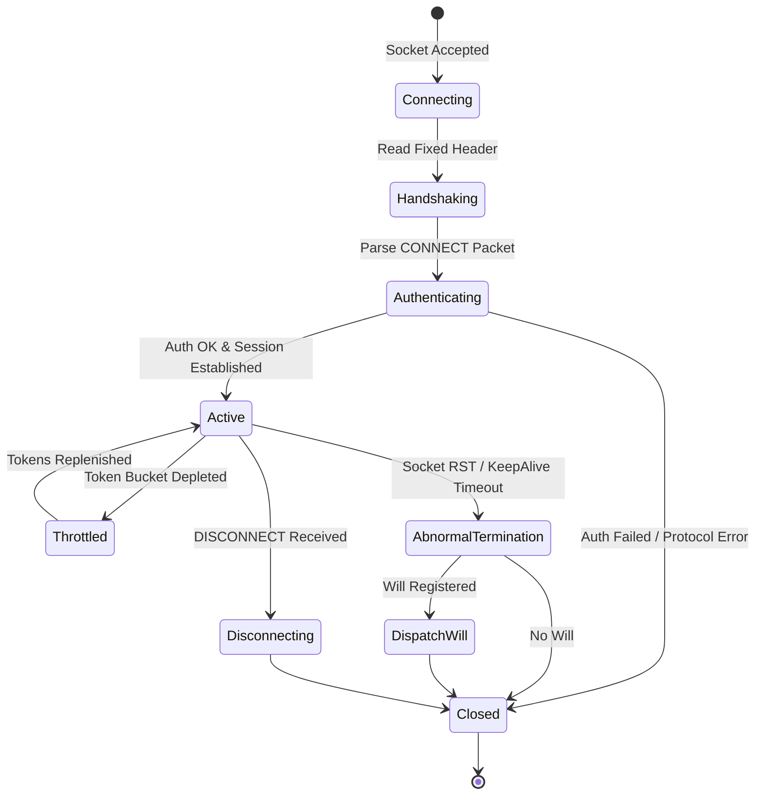

# Binnacle System Architecture

## 1. Overview

Binnacle is a distributed, high-throughput MQTT 5.0 telemetry broker, streaming event engine, and edge messaging hypervisor designed in Pike. It provides wire-compatible OASIS MQTT 5.0 and 3.1.1 ingestion, a hierarchical radix trie topic router, zero-copy QoS 0/1/2 delivery pipelines, an append-only Write-Ahead Log (WAL) with point-in-time snapshots, embedded Complex Event Processing (CEP) rules with tumbling and sliding windows, and inter-broker mesh clustering.

---

## 2. Component Decomposition

### 2.1 Network Ingress Layer
The ingress layer handles non-blocking asynchronous socket multiplexing across plain TCP, TLS, and RFC 6455 WebSockets. Each incoming client connection is immediately bound to a lightweight `ConnectionActor` that encapsulates transport buffers, parser state, rate limits, and keepalive tracking.

### 2.2 Streaming Wire Deserializer
The protocol parser processes streaming TCP byte chunks without assuming packet boundary alignment. Variable-byte integers (1 to 4 bytes) are dynamically resolved to compute the packet's Remaining Length, after which the parser verifies fixed header flags and instantiates the appropriate packet representation.

### 2.3 Radix Topic Trie Router
The topic routing fabric uses a radix trie where tree branches correspond to topic levels delimited by `/`. Single-level (`+`) and multi-level (`#`) wildcards are evaluated with zero heap allocations for static paths. Subscriptions with the `NoLocal` option prevent messages from looping back to their original publisher.

### 2.4 State Management and Session Registry
Client state is governed by MQTT 5.0 CleanStart and Session Expiry Interval rules. When a client disconnects with an active Session Expiry Interval, the session transitions to an inactive state while preserving offline queues, inflight packet windows, and subscription trees. Expired sessions are reaped by an asynchronous background cleaner.

### 2.5 Durability Subsystem (WAL)
Every state mutation (retained message updates, persistent session creation, subscription changes) is appended to an active 64 MB segment file with an 8-byte monotonic Log Sequence Number (LSN) and a hardware-optimized IEEE 802.3 CRC32 checksum. Crash recovery sequentially replays segment files and flags torn writes.

---

## 3. Connection Actor State Machine

---

## 4. Concurrency Model

Binnacle leverages Pike's hybrid concurrency model:
1. **Event-Driven I/O Multiplexing:** Socket read/write events are scheduled via Pike's native backend loop.
2. **Fine-Grained Mutex Locking:** Shared subsystem resources (Topic Trie, Session Registry, Inflight Windows, Metrics) utilize granular `Thread.Mutex` instances rather than a global broker lock. This ensures concurrent client throughput across multiple CPU cores without contention bottlenecks.
3. **Actor Isolation:** Each client connection operates as an independent actor maintaining its own token bucket shaper and packet identifier leasing pool.
