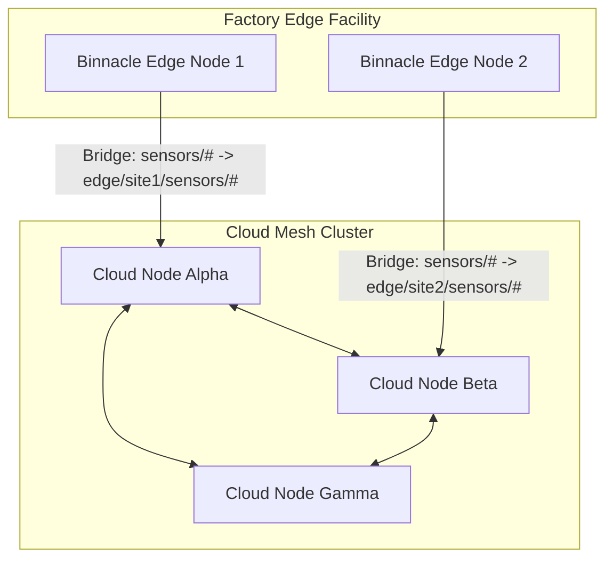

# Distributed Cluster Mesh and Edge Bridging

## 1. Topologies and Architecture

Binnacle supports two inter-broker interconnection models:
1. **Full-Mesh Clustering:** Symmetric peer-to-peer mesh designed for high-availability multi-node data center deployments. All nodes replicate published telemetry and propagate subscriber interest maps.
2. **Hierarchical Edge Bridging:** Asymmetric tree topology where edge gateway brokers selectively forward specific topic hierarchies to central cloud broker instances with topic namespace rewriting.



---

## 2. Cluster Mesh Framing Protocol

Inter-broker mesh synchronization uses a dedicated binary framing protocol:

```
+----------------------------------------------------------------------+
| Bytes 0..4   : Magic String ("BMESH", 5 bytes)                       |
+----------------------------------------------------------------------+
| Byte 5       : Message Type (1=Hello, 2=Heartbeat, 3=Pub, 4=Interest)|
+----------------------------------------------------------------------+
| Bytes 6..7   : Origin Node ID Length (16-bit Big-Endian)             |
+----------------------------------------------------------------------+
| Bytes 8..N   : Origin Node ID String (UTF-8)                         |
+----------------------------------------------------------------------+
| Byte N+1     : Hop Count (8-bit Integer, incremented on each forward)|
+----------------------------------------------------------------------+
| Bytes N+2..N+5: Payload Length (32-bit Big-Endian)                   |
+----------------------------------------------------------------------+
| Bytes N+6..M : Payload Body (Serialized Packet or Routing Table)     |
+----------------------------------------------------------------------+
| Bytes M+1..M+4: CRC32 Checksum (IEEE 802.3 Checksum over entire frame)|
+----------------------------------------------------------------------+
```

---

## 3. Loop Prevention and Convergence Guarantees

In an arbitrary network mesh, broadcast replication risks infinite packet circulation (routing loops or broadcast storms). Binnacle enforces two invariant safety mechanisms:

### 3.1 Origin Node Filtering
Every replication frame stamps the unique node identifier of the broker where the message entered the cluster. When a peer receives a frame:
- If `origin_node == local_node_id`, the packet has completed a cycle and is immediately dropped without further processing.

### 3.2 Maximum Hop Bound
Every forwarding hop increments the frame's `hop_count` byte. If `hop_count >= 16`, the packet is dropped and a warning log is recorded, mathematically guaranteeing that rogue packets terminate in finite steps even under dynamic topology partitions.

---

## 4. Edge Topic Bridging

Bridge configurations allow unidirectional or bidirectional synchronization across heterogeneous broker networks:

```
broker.bridge.target_host = "cloud-gw.binnacle.io"
broker.bridge.target_port = 8883
broker.bridge.direction = "out"
broker.bridge.mapping.1 = "sensors/# -> edge/site-01/sensors/#"
broker.bridge.mapping.2 = "alerts/#  -> edge/site-01/alerts/#"
```

- **Prefix Translation:** When forwarding from edge to cloud, Binnacle prepends namespaces to guarantee uniqueness and prevent collision across thousands of concurrent edge sites.
- **Connection Supervision:** If the remote uplink drops, the bridge buffers unacknowledged traffic in its local offline queue and initiates exponential backoff reconnect attempts.
