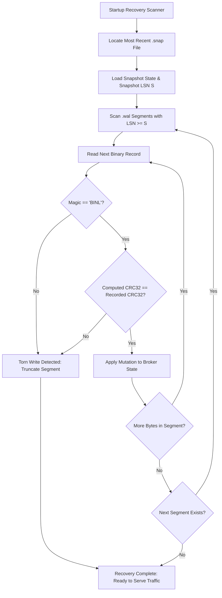

# Persistence Subsystem and Write-Ahead Log (WAL) Engine

## 1. Storage Architecture

Binnacle guarantees fault-tolerant state durability through a segmented, append-only Write-Ahead Log (WAL) combined with periodic state snapshots. Every state mutation (retained messages, session registrations, subscription tables) is committed to disk before acknowledging operations to network clients.

```
data/
  ├── snapshots/
  │   └── 0000000000000500.snap    # Point-in-time state snapshot at LSN 500
  └── wal/
      ├── 0000000000000501.wal     # Active WAL segment starting at LSN 501
      └── 0000000000000840.wal     # Rolled WAL segment starting at LSN 840
```

---

## 2. Binary Record Layout

Every WAL record begins with a fixed 25-byte binary header, followed by the variable-length payload and a trailing 4-byte CRC32 checksum:

```
+-----------------------------------------------------------------------+
| Bytes 0..3   : Magic String ("BINL", 0x42494E4C)                      |
+-----------------------------------------------------------------------+
| Byte 4       : Record Type (1=RetainPut, 2=RetainDel, 3=SessionUpsert)|
+-----------------------------------------------------------------------+
| Bytes 5..12  : Log Sequence Number (LSN, 64-bit Big-Endian Integer)  |
+-----------------------------------------------------------------------+
| Bytes 13..20 : Timestamp (Monotonic Nanoseconds, 64-bit Integer)      |
+-----------------------------------------------------------------------+
| Bytes 21..24 : Payload Length (32-bit Big-Endian Integer)             |
+-----------------------------------------------------------------------+
| Bytes 25..N  : Payload Data (UTF-8 Topic, Message Body, State JSON)   |
+-----------------------------------------------------------------------+
| Bytes N+1..N+4 : CRC32 Checksum (IEEE 802.3 Checksum over Bytes 0..N) |
+-----------------------------------------------------------------------+
```

---

## 3. Segment Rolling Policy

WAL segments roll over automatically to avoid oversized files:
- **Default Segment Limit:** 64 MB (configurable via `storage.max_segment_size`).
- **Filename Convention:** Zero-padded 16-digit hexadecimal string representing the first LSN contained within the segment (e.g., `0000000000000001.wal`).
- **Sync Policy:** Controlled by `storage.sync_on_write`. When enabled, every append issues an immediate `fsync` call to ensure physical magnetic/flash storage persistence. When disabled, OS page cache flushing yields higher write throughput while maintaining integrity via checksum recovery.

---

## 4. Crash Recovery and Torn-Write Detection

Upon startup, `StorageEngine` executes a two-phase recovery pass:



### Torn-Write Tolerance
In the event of an abrupt power failure during a write operation, the trailing record in the newest segment may be partially written. Binnacle calculates the IEEE 802.3 CRC32 across the entire record. If a partial header or checksum mismatch is encountered:
1. The corrupted partial tail is discarded and safely truncated.
2. All prior valid records within the segment remain intact and committed.
3. Recovery proceeds safely without data loss for confirmed transactions.
