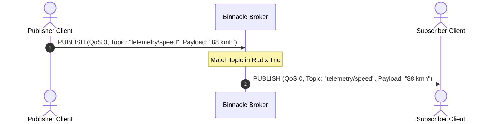
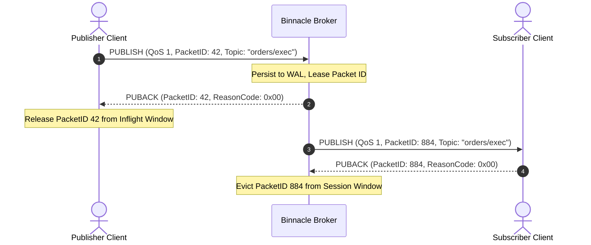
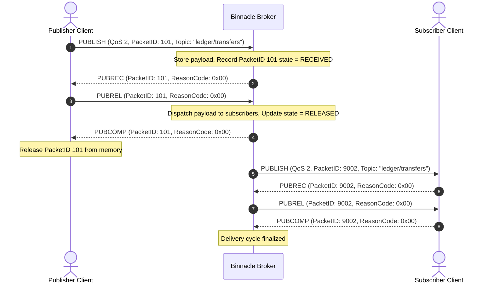

# Quality of Service (QoS) State Machines and Flow Control

## 1. QoS 0: At Most Once Delivery

QoS 0 provides non-blocking, fire-and-forget message delivery with zero acknowledgment overhead. It is optimized for high-frequency telemetry (e.g., GPS coordinates, accelerometer readings) where sporadic packet drops are preferable to transmission delays.

---

## 2. QoS 1: At Least Once Delivery

QoS 1 guarantees that messages arrive at least once by requiring an explicit `PUBACK` response. Both publisher and broker track packet identifiers in an in-flight window until acknowledged.

---

## 3. QoS 2: Exactly Once Delivery

QoS 2 employs a two-phase, four-step handshake (`PUBLISH -> PUBREC -> PUBREL -> PUBCOMP`) to ensure zero message loss and zero message duplication.

---

## 4. Inflight Window and Flow Control

Binnacle bounds outstanding unacknowledged messages using the MQTT 5.0 `ReceiveMaximum` parameter:
1. When a client advertises `ReceiveMaximum: N`, the broker will transmit at most $N$ unacknowledged QoS 1 and QoS 2 messages concurrently.
2. Additional messages directed to this subscriber are queued in the bounded `OfflineQueue` until the inflight window shrinks via incoming `PUBACK` or `PUBCOMP` packets.
3. If the broker's own `ReceiveMaximum` is exceeded by an aggressive publisher, Binnacle terminates the connection with Reason Code `0x93` (`Receive Maximum Exceeded`).

---

## 5. Packet Identifier Pool Architecture

Packet IDs in MQTT are 16-bit unsigned integers in the range $[1, 65535]$. The value 0 is forbidden by the specification.

Binnacle manages packet identifiers via a thread-safe recycling pool (`PacketIdPool`):
- Monotonic pointer incrementing from 1 to 65535 before wrapping back to 1.
- Multiset index tracking currently leased IDs: $O(1)$ lookup and release.
- If all 65,535 IDs are simultaneously in flight, the pool raises `QuotaExceededError` (`0x97`), protecting broker memory from unbounded exhaustion.
