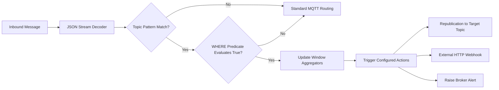

# Embedded Stream Processing and Complex Event Rules Engine

## 1. Engine Overview

Binnacle includes a native Complex Event Processing (CEP) and stream analytics pipeline that executes inline against published telemetry streams. Without requiring external processing infrastructure (such as Apache Flink or Kafka Streams), Binnacle can parse incoming payloads, evaluate SQL-like predicates, maintain sliding time-window aggregates, and trigger reactive actions.



---

## 2. Declarative Rule Syntax

Rules are defined in configuration using a declarative SQL-like dialect:

```sql
SELECT payload.telemetry.speed_kmh, payload.telemetry.battery_soc
FROM "fleet/+/telematics"
WHERE payload.telemetry.speed_kmh > 120.0 AND payload.telemetry.battery_soc < 15.0
ACTION REPUBLISH TO "fleet/alerts/high_speed_low_battery"
```

### Supported Operators
- Relational comparisons: `>`, `<`, `>=`, `<=`, `==`, `!=`
- String substring containment: `CONTAINS`
- Boolean conjunctions: `AND`

---

## 3. JSONPath Extraction Engine

The nested JSON extractor (`JsonPath`) resolves structured values using path strings:
- Dot notation: `vehicle.engine.temperature`
- Array indexing: `sensors[0].reading`
- Nested compound paths: `facilities[1].assembly_lines[0].press.vibration`

If an indexed element or key does not exist, the extractor returns a null sentinel, preventing runtime exceptions and allowing optional fields in heterogeneous IoT deployments.

---

## 4. Streaming Window Aggregations

Binnacle implements two windowing models for numerical streaming time-series:

### 4.1 Tumbling Windows
Fixed-length, non-overlapping time intervals. At the expiration of each duration $W$, summary statistics are emitted and the observation buffer is reset.

### 4.2 Sliding Windows
Continuous, overlapping time intervals that maintain a rolling buffer of observations within the last $W$ seconds. Expired samples are evicted on every evaluation:

$$\mu = \frac{1}{N} \sum_{i=1}^N x_i, \quad \sigma = \sqrt{\frac{1}{N} \sum_{i=1}^N (x_i - \mu)^2}$$

Every aggregation computes:
- Sample count ($N$)
- Arithmetic mean ($\mu$)
- Minimum and Maximum values ($\min(X), \max(X)$)
- Summation ($\sum X$)
- Sample standard deviation ($\sigma$)

---

## 5. Reactive Action Dispatchers

When a rule's predicate evaluates to true or an aggregated metric exceeds an alert threshold, the rule dispatches configured actions:
1. **Republication Action:** Publishes an enriched JSON event to a derived MQTT topic with designated QoS and Retain flags.
2. **Webhook Action:** Executes an asynchronous HTTP POST request to an external edge microservice or cloud endpoint.
3. **Log Action:** Emits a structured log line for auditing and security compliance.
